# Kill Clog

[](https://runelite.net/plugin-hub/show/kill-clog)

HiScores, Collection Logs, Personal Bests, and player comparison in one RuneLite panel.

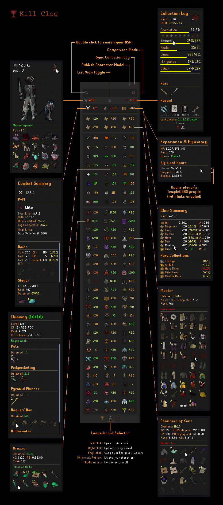

## Setup

Install **Kill Clog** from the RuneLite Plugin Hub and open its panel while logged in. Your account loads automatically.

Open your Collection Log and leave it open until setup confirms completion in chat. Setup runs automatically.

Your log is saved locally and updates with new unlocks as you play. Open the Collection Log any time to catch items you got on mobile or another device.

To retry an update, reopen the log or choose **Search** at the top. If it says **RuneProfile**, right-click it and choose **Search**. Interrupted updates keep your saved log.

## Kill Clog Web Sync

Optional and off by default.

**Sync Collection Log** keeps your killclog.com profile up to date with your Collection Log, unlock dates, personal bests and clan. The chalice button (**sync collection log**) syncs right away. Open the in-game log first so it's current.

**Automatic sync** turns on with Sync Collection Log: your profile updates at login, after new items, and when you open your Collection Log. Turn it off to sync only when you click the chalice.

**Publish Character Model** needs Sync Collection Log and turns on with it. It adds the **publish character** button beside the chalice, which publishes your character and follower in your real appearance. Anyone who looks you up in Kill Clog sees them in your Player Summary. Hold shift on the button and it reads **delete character model**: a shift-click removes your character from killclog.com, and nothing else changes.

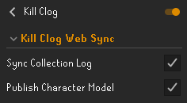

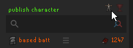

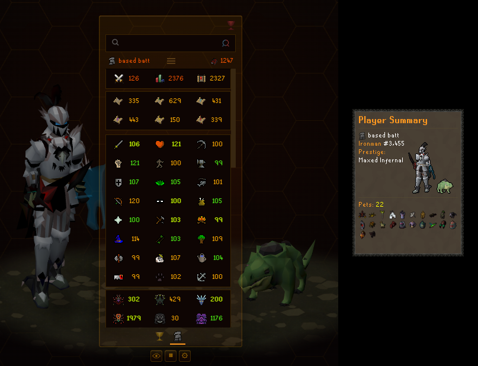

Each button flashes green when your click goes through.

## Skill Clogs

Every skill has its own Collection Log-style progression. Skill cards combine relevant activities, equipment, and unlocks with the skill's level, XP, rank, and XP to next level.

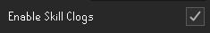

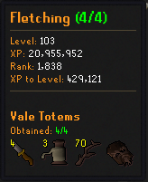

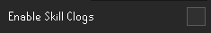

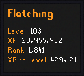

## Player Lookup

Enter an RSN in the search bar, or right-click a supported player or name and choose **Kill Clog**.

Use the comparison button beside the search bar to load a second player.

While a League runs, a **Leagues** switch beside the search bar flips the panel between League and main game stats.

**Recommended for a full HiScore replacement:** Turn off RuneLite's **HiScore** plugin and set **Menu Label** to **Lookup** in Kill Clog's settings.

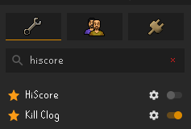

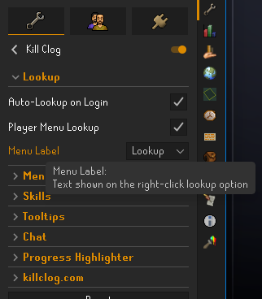

HiScores load for any valid RSN, including Collection Log totals and ranks when listed. Item-by-item Collection Log details appear when that player has data available through TempleOSRS, RuneProfile, or Kill Clog.

Your clan comes from the game. Other players' clans come from their Kill Clog sync, or from RuneProfile when they have a profile there.

Hover your Collection Log total to see your log, and click it to pin and browse every tab and page.

Shift-click anything that opens a card, or right-click it and choose **Copy**, and the card opens and is copied to your clipboard as a picture, ready to paste into Discord.

Hold the middle mouse button over the panel and move up or down to scroll, faster the farther you move; let go to stop.

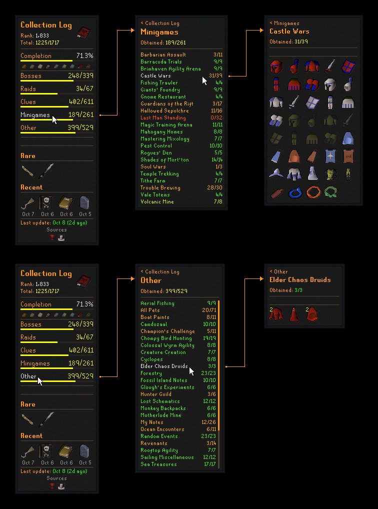

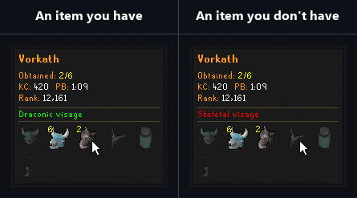

## Resource Pack Themes

Kill Clog draws its cards with the game's own interface frames, so they wear whichever Resource Pack you use.

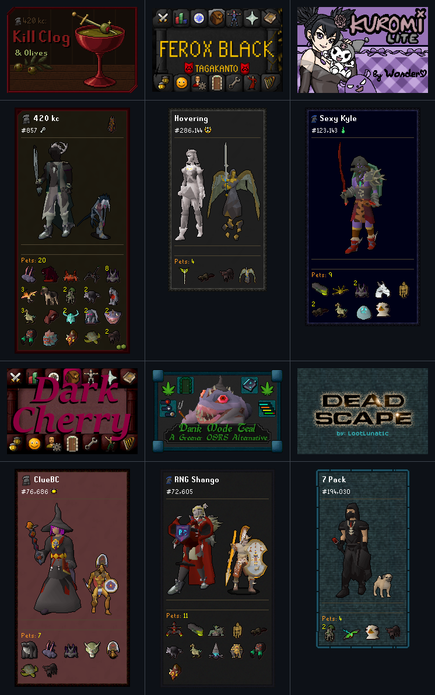

## Grid and List views

Toggle between the default Grid view and List view with the **Menu** button under the search bar. Comparison uses Grid view.

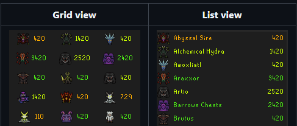

## Leaderboard selector

Turn on **Show Leaderboard Selector** under **Lookup** to switch between the hiscores a player is on, using the icons below the grid.


A Hardcore who died keeps their stats from the moment of death on the Hardcore tab, marked with a skull on the helm. A de-ironed account's old Ironman stats get a crossed-out helm. Comparisons and new lookups always use each player's own leaderboard.

## Chat Commands

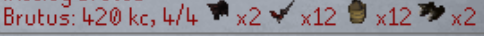

| Command | Result |
| --- | --- |
| `!kclog [page]` | Collected items and duplicate quantities |
| `!missing [page]` | Missing items |
| `!3a` | Third-age progress |
| `!gilded` | Gilded progress |
| `!kc [item name]` | KC when the item was obtained, if recorded locally |

Use any Collection Log page, including pages outside the panel. Try `!kclog pets`, `!kclog mixology`, `!kclog random events`, or `!missing medium clues`. Pet totals count unique pets; quantities beside sprites show dupes.

**Keep RuneLite's Chat Commands enabled** for `!pets`, `!clues medium`, `!kc [boss]`, and `!pb [boss]`. It is separate from the HiScore plugin.

RuneProfile handles `!log` while enabled. With RuneProfile off, Kill Clog handles `!log [page]` and `!log missing [page]`.

Full page names work, and shorthand such as `gotr`, `mixology`, `pets`, and `hydra` works too. See the [full page and shortcut chart](docs/chat-commands.md#page-names-and-shorthand) for every supported alias, command ownership, and examples. Skill Clog aggregates are not separate chat pages.

## Settings

- **Kill Clog Web Sync:** Sync Collection Log, Automatic sync, Quiet automatic sync, Publish Character Model, and Share Clan (off, your sync says you are in no clan)
- **Card Appearance:** card activation, cell hover feedback, card links (on a click, only on a shift-click, or off), the KC (or Glory), PB and rank lines, and colors for labels, values, dividers, backgrounds and borders
- **Lookup:** automatic lookup on login, player comparison, the player-menu lookup and its label, and the leaderboard selector
- **Menu location:** which right-click menus show Kill Clog (players, friends, ignore, clan and guest clan lists, chat channels, public chat, private messages, Group Ironman)
- **Skills:** location, virtual levels, level color, color mode (skill colors, 99+, or Skill Clog progress), and Skill Clogs on or off
- **Chat:** plugin messages and custom emojis (`:killclog:` `:rune:` `:dragon:` `:gilded:` `:clog:` `:green:`)
- **Progress Highlighter:** on or off, the summary bar's text color, and the Collection Log progress colors (completed, 1 away, in progress, empty)

## Data and privacy

Kill Clog contacts secure.runescape.com (Jagex HiScores), templeosrs.com ([TempleOSRS](https://templeosrs.com)), api.runeprofile.com ([RuneProfile](https://runeprofile.com), which also names other players' clans), and killclog.com. With card links on, clicking an item, a card's title or a source opens it in your browser: oldschool.runescape.wiki, templeosrs.com, runeprofile.com or killclog.com. A developer-only setting sends sync to staging.killclog.com instead. Each request shows your IP address to the host it contacts, which is why RuneLite shows a third-party warning on install.

Web publication is opt-in. Nothing from your local Collection Log is published until you enable **Sync Collection Log**. Disable that setting to stop all web publication, or **Publish Character Model** to stop character updates. A shift-click on the publish character button removes your character at any time. Other published data remains until you request deletion through the [opt-out page](https://killclog.com/p/opt-out.html).

TempleOSRS EHB rates are bundled with the plugin and refreshed with releases. Computing EHB does not make another request.

The source is public at [github.com/420kc/kill-clog-plugin](https://github.com/420kc/kill-clog-plugin).

## Development

Kill Clog builds with Java 11 and the included Gradle wrapper.

```powershell
.\gradlew.bat clean compileJava checkstyleMain checkstyleTest test jar
```

Launch the development client with:

```powershell
.\gradlew.bat run
```

The release jar is written to `build/libs/`.

## Support

If setup, a total, an item mapping, or a card looks wrong, open an [issue](https://github.com/420kc/kill-clog-plugin/issues) with your Kill Clog version, the RSN, and a screenshot.
