# Kill Clog

[](https://runelite.net/plugin-hub/show/kill-clog)

HiScores, Collection Logs, Personal Bests, and player comparison in one RuneLite panel.


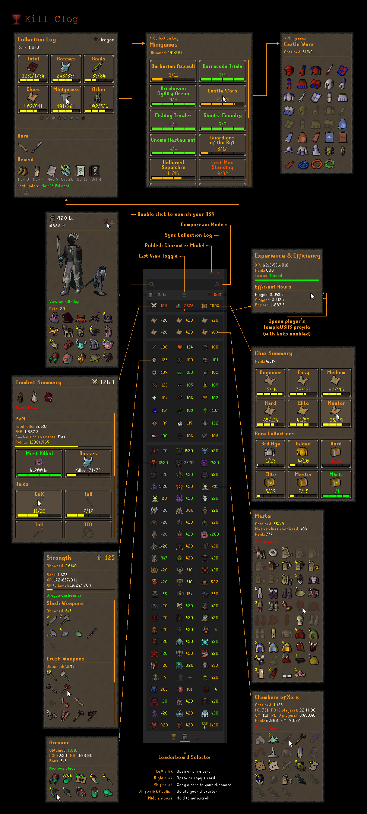

## Setup

Install **Kill Clog** from the RuneLite Plugin Hub and open its panel while logged in. Your account loads automatically.

Open your Collection Log and leave it open until setup confirms completion in chat. An empty log (a new account, or a Hardcore Worlds character after a death) sets itself up at login, with nothing to open.

Your log is saved locally and updates with new unlocks as you play. Open the Collection Log any time to catch items you got on mobile or another device. To retry an update, reopen the log or choose **Search** at the top (if it says **RuneProfile**, right-click it and choose **Search**). Interrupted updates keep your saved log.

## Player Lookup

Enter an RSN in the search bar, or right-click a supported player or name and choose **Kill Clog**.

HiScores load for any valid RSN, Collection Log totals and ranks included. Item-by-item Collection Logs appear when a player has data through TempleOSRS, RuneProfile, or Kill Clog. Your clan comes from the game; other players' clans from their Kill Clog sync, or RuneProfile.

While a League runs, a **Leagues** switch beside the search bar flips the panel between League and main game stats.

**For a full HiScore replacement:** turn off RuneLite's **HiScore** plugin and set **Menu Label** to **Lookup**.

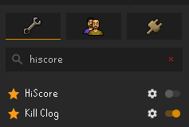

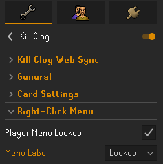

## Cards

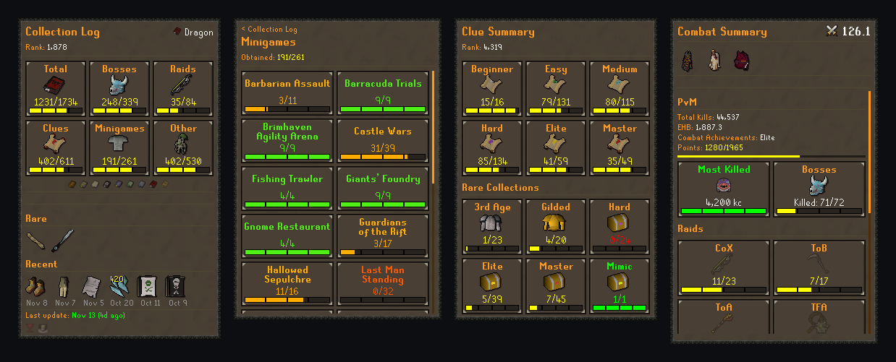

Hover an item to name it, green when you have it and red when you don't.

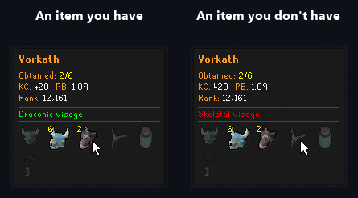

Shift-click anything that opens a card, or right-click it and choose **Copy**, and the card is copied to your clipboard as a picture, ready to paste into Discord.

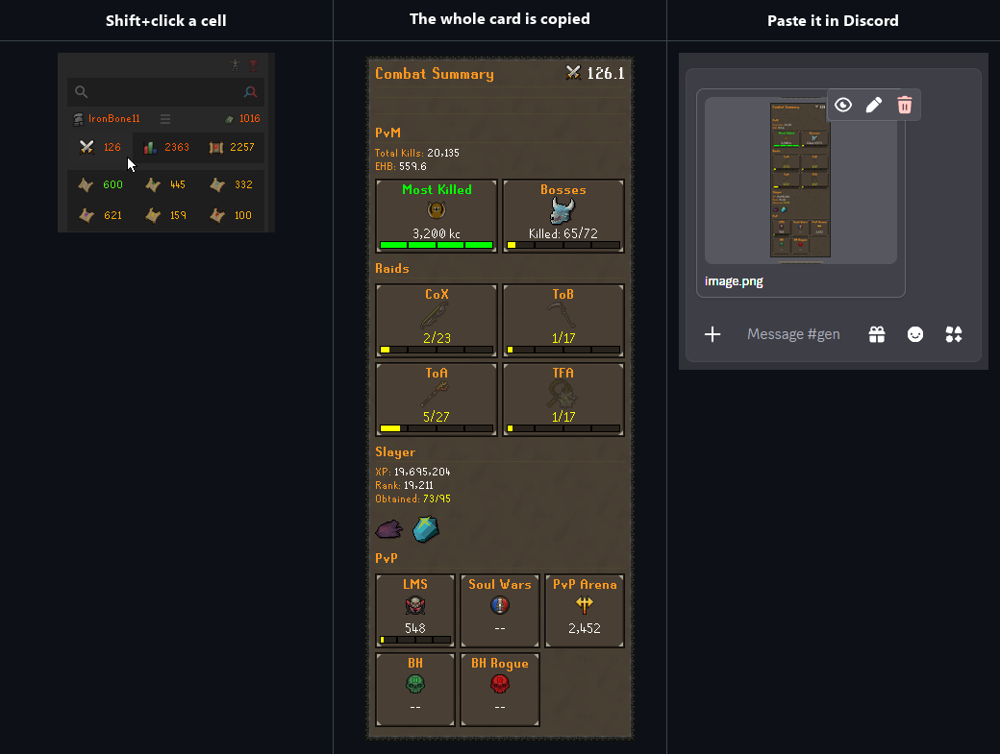

The Player Summary's top bar links to the player's Kill Clog, TempleOSRS and RuneProfile pages. The Combat Summary shows their prestige cape and Dizana's quiver, which becomes Dizana's max cape in the max cape's place once they're maxed.

Some counts appear only on the game's own Collection Log pages, like Revenant kills, Hunter Guild rumours and the raids' Entry completions. Open a page and its card shows the count from then on, here and on killclog.com, updated when you next open the page after it changes.

## Grid and List views

The **Menu** button under the search bar switches between Grid and List. List view has its own search: by boss, activity, kill count or item name. An item finds every boss and Collection Log page that holds it, like Chambers of Xeric for a twisted bow, once you're logged in.

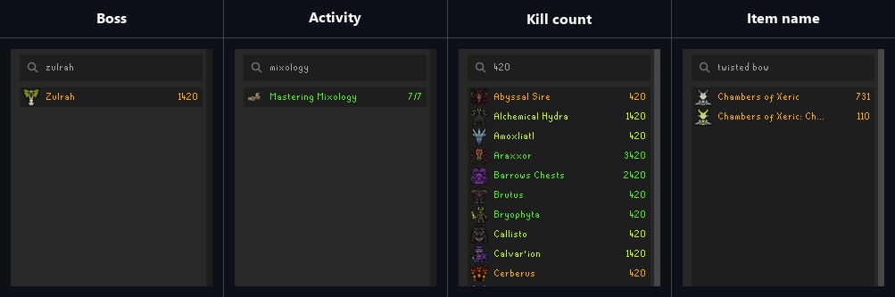

Activities with no boss row, like Mastering Mixology, show their count and open their own card. Comparison uses Grid view.

## Combat & Skill Clogs

Every skill has its own Collection Log-style progression. Attack, Strength, Defence, Ranged, Magic, Prayer and Hitpoints list the gear each skill unlocks, grouped the way the game does and ordered by level.

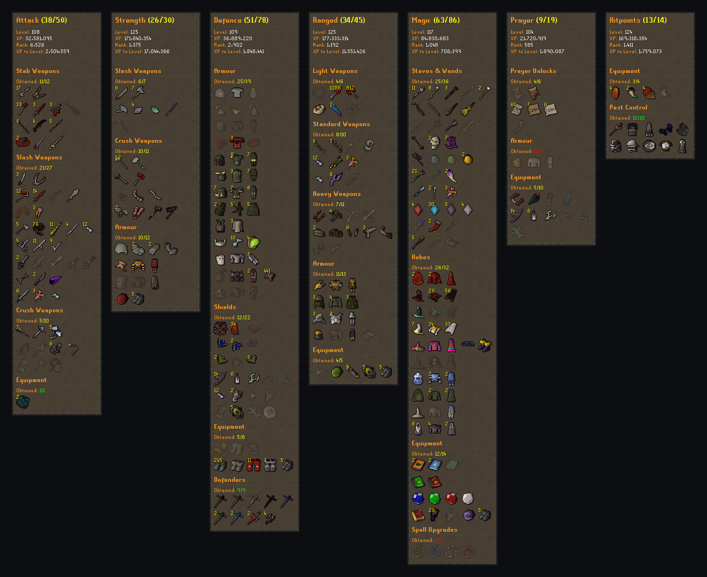

Skill cards combine the skill's activities, equipment and unlocks with its level, XP, rank, and XP to next level. With **Enable Skill Clogs** off, a skill card shows the skill alone.

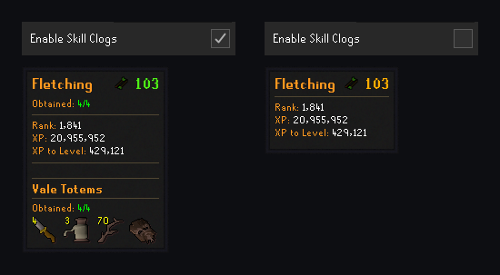

## Comparison

The comparison button beside the search bar loads a second player. Every number and card compares the two side by side, the first player in blue and the second in red.

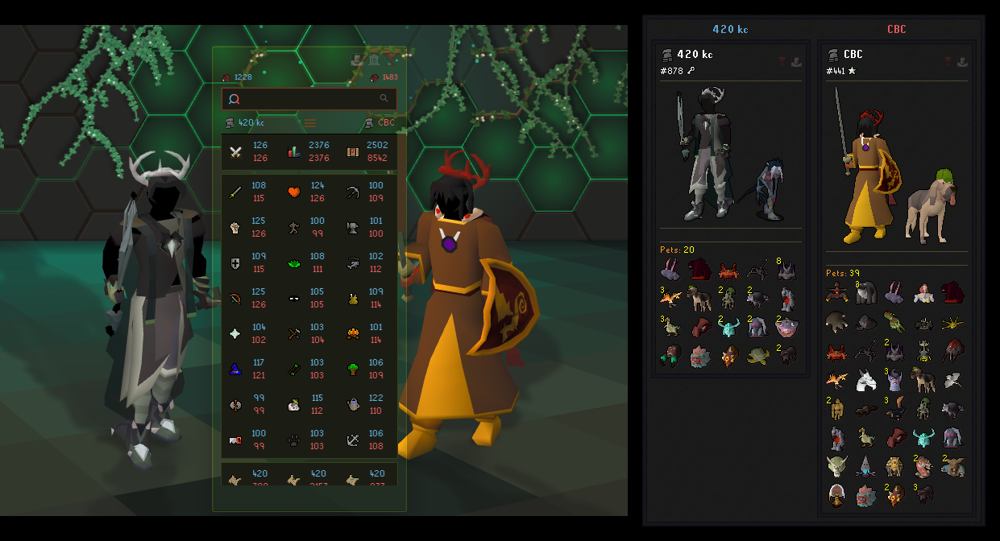

## Leaderboard selector

Turn on **Show Leaderboard Selector** under **General** to switch between the hiscores a player is on, with the icons below the grid. The Player Summary wears the player's badge.

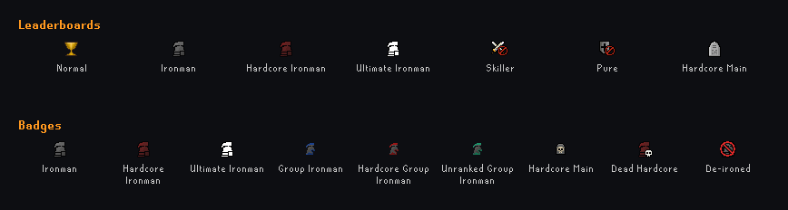

A Hardcore who died keeps their stats from the moment of death on the Hardcore tab, marked with a skull on the helm. A de-ironed account's old Ironman stats get a crossed-out helm. Comparisons and new lookups always use each player's own leaderboard.

## Chat Commands

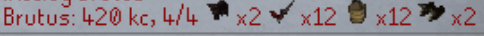

| Command | Result |
| --- | --- |
| `!kclog [page]` | Collected items and duplicate quantities |
| `!missing [page]` | Missing items |
| `!3a` | Third-age progress |
| `!gilded` | Gilded progress |
| `!kc [item name]` | KC when the item was obtained, if recorded locally |

Any Collection Log page works, including pages outside the panel, by full name or shorthand (`gotr`, `hydra`): `!kclog pets`, `!kclog mixology`, `!kclog random events`, `!missing medium clues`. Pet totals count unique pets; quantities beside sprites show dupes. The [full page and shortcut chart](docs/chat-commands.md#page-names-and-shorthand) lists every alias. Skill Clog aggregates are not separate chat pages.

**Keep RuneLite's Chat Commands enabled** for `!pets`, `!clues medium`, `!kc [boss]`, and `!pb [boss]`; it is separate from the HiScore plugin. RuneProfile handles `!log` while enabled. With RuneProfile off, Kill Clog handles `!log [page]` and `!log missing [page]`.

## Resource Pack Themes

Kill Clog draws its cards with the game's own interface frames, so they wear whichever Resource Pack you use.

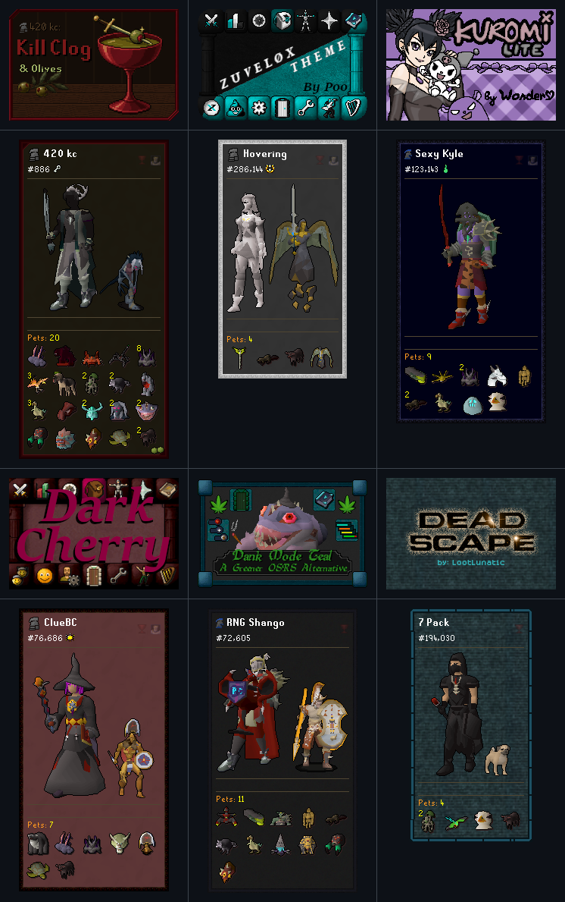

## Kill Clog Web Sync

Optional and off by default. Your synced log and character show on [killclog.com](https://killclog.com) and in Kill Clog lookups.

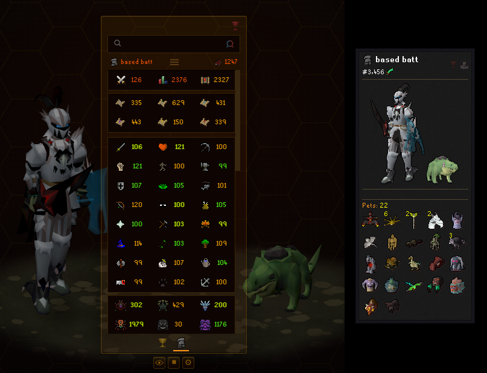

**Sync Collection Log** keeps your killclog.com profile up to date with your Collection Log, unlock dates, personal bests and clan. The chalice (**sync collection log**) syncs right away; open the in-game log first so it's current. **Automatic sync** turns on with it: your profile updates at login, after new items, and when you open your Collection Log. Turn it off to sync only when you click the chalice.

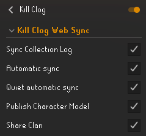

**Publish Character Model** needs Sync Collection Log and turns on with it. Its **publish character** button beside the chalice publishes your character and follower in your real appearance, and anyone who looks you up sees them in your Player Summary. Hold shift and it reads **delete character model**: a shift-click removes your character from killclog.com, and nothing else changes. Each button flashes green when your click goes through.

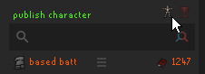

## Settings

- **Kill Clog Web Sync:** Sync Collection Log, Automatic sync, Quiet automatic sync, Publish Character Model, and Share Clan (off, your sync says you are in no clan)
- **General:** automatic lookup on login, player comparison, the leaderboard selector, Sidebar Priority (where the Kill Clog icon sits in the sidebar; lower is higher), chat messages and custom emojis (`:killclog:` `:rune:` `:dragon:` `:gilded:` `:clog:` `:green:`)
- **Card Settings:** card activation, cell hover feedback, card links (on a click, only on a shift-click, or off), the KC (or Glory), PB and rank lines, and colors for labels, values, dividers, backgrounds, borders and scroll bars
- **Right-Click Menu:** the Kill Clog lookup option, its label, and which right-click menus show it (players, friends, ignore, clan and guest clan lists, chat channels, public chat, private messages, Group Ironman)
- **Skills:** location, Skill Clogs on or off, virtual levels, color mode (Skill Clog progress, Level Progression, or one skill color), and the level color
- **Progress Highlighter:** on or off, the summary bar's text color, and the progress colors (completed, 1 away, in progress, empty) for Collection Logs and for levels in Level Progression

## Support

Help and updates are in the [Kill Clog Discord](https://killclog.com/discord). If setup, a total, an item mapping, or a card looks wrong, post there with your Kill Clog version, the RSN, and a screenshot.

## Data and privacy

Kill Clog contacts secure.runescape.com (Jagex HiScores), templeosrs.com ([TempleOSRS](https://templeosrs.com)), api.runeprofile.com ([RuneProfile](https://runeprofile.com), which also names other players' clans), and killclog.com. With card links on, clicking an item, a card's title or a source opens it in your browser: oldschool.runescape.wiki, templeosrs.com, runeprofile.com or killclog.com. A developer-only setting sends sync to staging.killclog.com instead. Each request shows your IP address to the host it contacts, which is why RuneLite shows a third-party warning on install.

Web publication is opt-in. Nothing from your local Collection Log is published until you enable **Sync Collection Log**. Disable that setting to stop all web publication, or **Publish Character Model** to stop character updates. A shift-click on the publish character button removes your character at any time. Other published data remains until you request deletion through the [opt-out page](https://killclog.com/p/opt-out.html).

TempleOSRS EHB rates are bundled with the plugin and refreshed with releases. Computing EHB does not make another request.

The source is public at [github.com/420kc/kill-clog-plugin](https://github.com/420kc/kill-clog-plugin).

## Development

Kill Clog builds with Java 11 and the included Gradle wrapper.

```powershell
.\gradlew.bat clean compileJava checkstyleMain checkstyleTest test jar
```

Launch the development client with:

```powershell
.\gradlew.bat run
```

The release jar is written to `build/libs/`.
